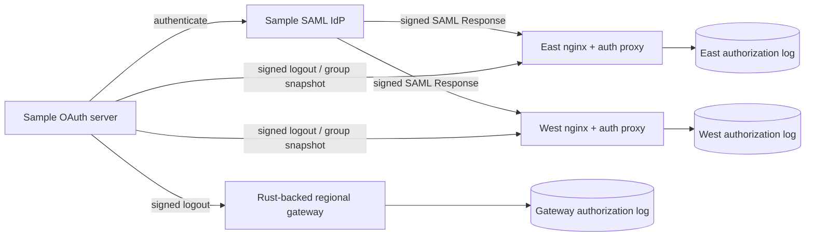

# OAuth-backed SAML, nginx and real-time revocation

This local lab runs the existing sample OAuth server, an OAuth-backed SAML IdP,
and two nginx/SAML-auth-proxy pairs representing East and West. It demonstrates
group changes on existing sessions and revocation of browser sessions and OAuth
API access. It creates no cloud resources.

## Protocol and interoperability

Okta supports server-to-server Universal Logout through signed Global Token
Revocation requests. GTR is an evolving IETF draft, not a finalized RFC. This
receiver implements the documented `global-token-revocation+jwt` profile with
issuer, application subject, exact endpoint audience, lifetime and unique JWT
ID, plus an `iss_sub` user identifier in the POST body. Email alias revocation
is unsupported: issuer-qualified IDs avoid ambiguous linking.
See [Okta's protocol](https://developer.okta.com/docs/guides/oin-universal-logout-overview/)
and the [IETF draft](https://datatracker.ietf.org/doc/html/draft-parecki-oauth-global-token-revocation).

The verifier accepts pinned ES256 or RS256 keys. The sample sender uses ES256.
An RS256 registration has `issuer`, `kid`, `alg: RS256` and RSA JWK `n`/`e`;
ES256 uses the existing debug `verification_key` structure. An event cannot
supply a discovery URL or verification key. No live Okta tenant is tested here.

Okta also documents CAEP session-revoked and credential-change events through
Shared Signals. This sample does not implement SSF stream management or SET
delivery. Group changes use a separately named debug protocol, rather than
pretending Universal Logout supplies group updates.
See [Okta's supported SSF events](https://developer.okta.com/docs/reference/ssf-transmitter-sets/).
A production group adapter could reconcile authenticated
[Okta event hooks](https://developer.okta.com/docs/concepts/event-hooks/)
into versioned local membership snapshots. That hook adapter is not implemented.

## Components and trust



The IdP authenticates a debug client ID/secret at the OAuth server, verifies the
access token, and issues a signed SAML Response under a pinned local certificate.
This reuses OAuth identities; it is not a human authorization-code login flow.

Each nginx protects `/app` with `readers` and `/admin` with `operators`, using an
uncached [`auth_request`](https://nginx.org/en/docs/http/ngx_http_auth_request_module.html)
for every request. Nginx overwrites the downstream identity header. The auth
subrequest is internal; login, callback and event routes reach the auth proxy.
Backends listen only on loopback.

The consumer delegates XMLDSig to [SignXML](https://xml-security.github.io/signxml/),
pins the certificate, RSA-SHA256 and SHA256 digests, and reads only the verified
tree. It accepts one signed Response containing one Assertion. It checks issuer,
audience, destination, recipient, lifetime, browser-bound request correlation
and replay. This is a constrained SP-initiated Redirect/POST SAML profile.

## Run locally

From the repository root:

```bash
python3 -m venv /tmp/zc-auth-venv
/tmp/zc-auth-venv/bin/pip install -r scripts/requirements-saml-debug.txt
nginx -V # must include --with-http_auth_request_module
CARGO_TARGET_DIR=/tmp/zc-auth-target CARGO_PROFILE_DEV_DEBUG=0 CARGO_INCREMENTAL=0 \
  cargo build --locked --bin zc-federation-auth-debug
/tmp/zc-auth-venv/bin/python scripts/zc-auth-saml-revocation-e2e.py \
  --nginx /usr/sbin/nginx \
  --driver /tmp/zc-auth-target/debug/zc-federation-auth-debug \
  --evidence /tmp/zc-saml-evidence
```

An nginx binary extracted from a distribution package under `/tmp` also works;
there is no need to start the system service. The runner creates isolated nginx
configuration, random loopback ports and private temporary keys/logs. It stops
its nginx PID and HTTP listeners in `finally`, including on Ctrl-C or SIGTERM.
Evidence contains decisions, not credentials. Private run files remain in
`/tmp/zc-saml-revocation-*`; remove the relevant directory after inspecting the
run. Never publish `lab.json`, cookies, assertions, tokens or SQLite files.

With `--driver`, tests also replicate encrypted debug data, accept OAuth tokens
in both logical regions, commit logout, and reject otherwise unexpired tokens
before reads or mutations. The same subject from another issuer retains its
explicit grants. Without that option, only the nginx/SAML path is tested.

## Demonstrate live group changes

Add `--serve` to the command. After testing, it restores `readers` and
`operators` at version 5 and prints regional URLs and the private `lab.json`
path. Visit `REGION_URL/login`, enter the `alice` debug client credentials from
that private file, and select Continue. The runner never prints credentials.
Demo sessions last two minutes; sign in again if they expire during the exercise.

Use the printed private path in another terminal:

```bash
# Keep this browser cookie; remove operator permission at both endpoints.
/tmp/zc-auth-venv/bin/python scripts/zc-auth-debug-event.py \
  --lab /tmp/zc-saml-revocation-RUN/lab.json --kind groups --version 6 --group readers

# /admin now returns 403; /app succeeds. Restore permission:
/tmp/zc-auth-venv/bin/python scripts/zc-auth-debug-event.py \
  --lab /tmp/zc-saml-revocation-RUN/lab.json --kind groups --version 7 \
  --group readers --group operators

# Remove every mapped group, then revoke both regional sessions:
/tmp/zc-auth-venv/bin/python scripts/zc-auth-debug-event.py \
  --lab /tmp/zc-saml-revocation-RUN/lab.json --kind groups --version 8
/tmp/zc-auth-venv/bin/python scripts/zc-auth-debug-event.py \
  --lab /tmp/zc-saml-revocation-RUN/lab.json --kind revoke
```

Snapshots sign the user, groups and monotonically increasing per-subject
version. Old versions cannot restore removed privileges. Groups grant only
preconfigured routes, not arbitrary tenant permissions, budget changes,
global failover permission or independent approval. Old assertion attributes
are not the ongoing authorization source.

Use `--destination east` or `west` to demonstrate partial delivery. A change in
East does not mean West has received it. Each has an independent local log.
The helper reports acknowledged destinations and errors on a failed delivery.
Recover partial snapshot fanout by sending a newer version to both endpoints;
for logout, send another logout. There is no durable sender outbox in this lab.

## Authorization-log semantics

Each receiver commits the authenticated event and enforcement state together in
SQLite with `synchronous=FULL`. Logout deletes matching sessions and records
an issuer-qualified issuance cutoff, rejecting access tokens with `iat` at or
before it, even before `exp`. Same-second issuance is denied conservatively.
A new authenticated login after the cutoff is allowed. Logout does not disable
the account or revoke its OAuth client secret at the issuer.

Event-JWT `sub` identifies the application. The person appears in `sub_id`.
Authorities can affect only their registered identity namespace. Exact retries
are idempotent; a reused JWT ID with different claims/body fails. Enforcement
survives reopening state. Access tokens cannot substitute for event tokens.
This durability covers adapter restarts while the private filesystem survives;
the default `/tmp` directory is disposable and may be backed by memory.

The regional adapter opts in with `authorization_log`, `identity_keys`,
`identity_audience` and `revocation_authorities` in its private config. Each
listener accepts `POST /global-token-revocation`. The OAuth sample's
operator-authenticated `POST /debug/events` sends only to administrator-pinned
`event_destinations`. Normal OAuth clients cannot send administrative events.

Real-time means the next checked request after that receiver commits the event.
The evidence records local group-update delivery/check time; this is not a WAN
guarantee or cancellation of already executing work. Unavailable state fails
closed rather than reusing a cached positive authorization.

## Production boundaries

Production management listeners retain their existing credentials. This lab
does not change production Raft commands. Remaining integration includes the
actual replicated policy log, regional freshness/fencing bounds, durable event
delivery/retries/reconciliation, trusted key rotation and live-provider tests.
Production revocation must cover refresh tokens, all sessions and long-lived
streams as applicable. The sample issues no refresh tokens.

Use TLS, established production SAML middleware, a browser OAuth flow, Secure
cookies and backend isolation for a deployment. This demo uses loopback HTTP,
SameSite=Lax cookies and a dummy backend. SAML Single Logout, general SAML
metadata interoperability and SSF/CAEP APIs remain separate integrations.
